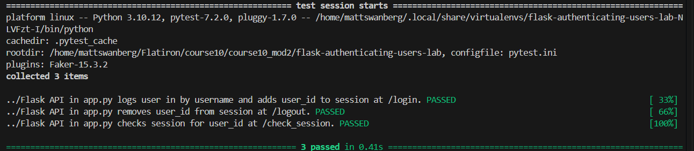

# Lab: Authenticating Users

## Overview

This project implements a basic user authentication system using Flask, Flask-RESTful, SQLAlchemy, and Flask sessions.

The application includes a Flask API backend and a React frontend. Users can log in with their username, remain logged in after refreshing the page, and log out when finished.

This lab builds upon the previous Cookies and Sessions lab by introducing user authentication and session persistence.

**Note:** This is an educational authentication system that uses usernames without passwords. Production applications require additional security measures, including password verification.

## Technologies Used

- Python
- Flask
- Flask-RESTful
- Flask-SQLAlchemy
- Flask-Migrate
- Marshmallow
- SQLite
- React
- JavaScript
- Pipenv
- Pytest

## Features

### User Login

Users can authenticate by submitting their username through the `/login` endpoint.

The application:

- Retrieves the username from the incoming JSON request.
- Searches the database for the corresponding user.
- Stores the authenticated user's ID in the Flask session.
- Returns the serialized user information.
- Returns an unauthorized

## Screenshot

### Test Suite Results

## Author

Created by Matthew Swanberg as part of Course 10 Module 2 (Lab: Authentication Users)
